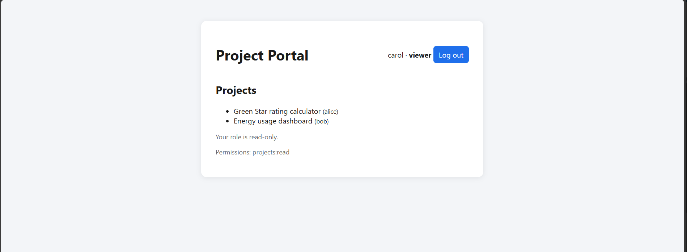
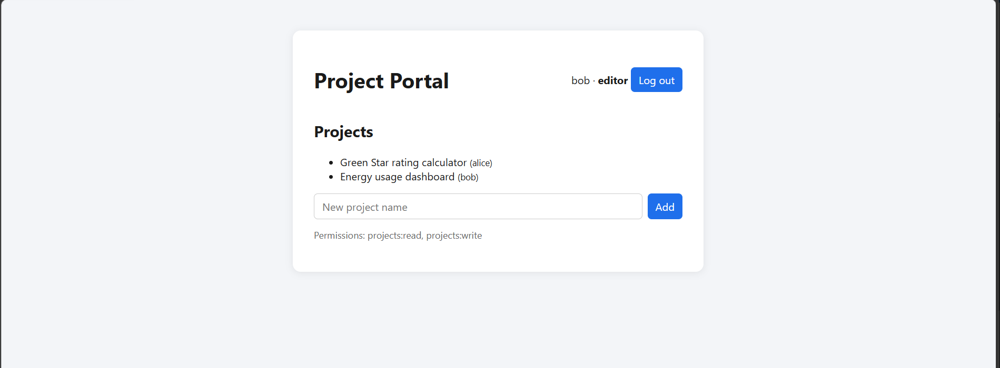
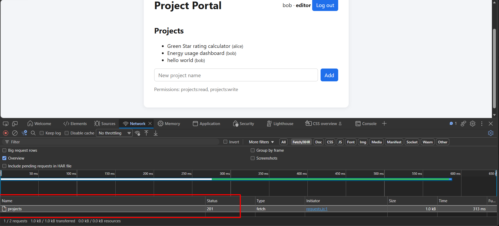
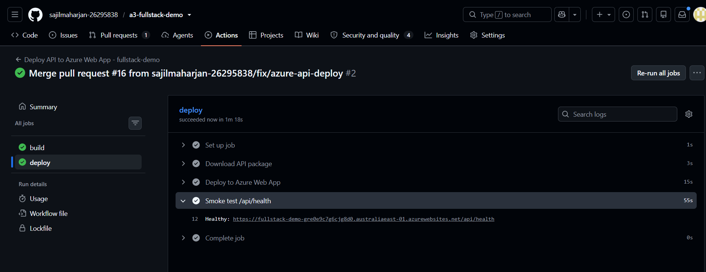
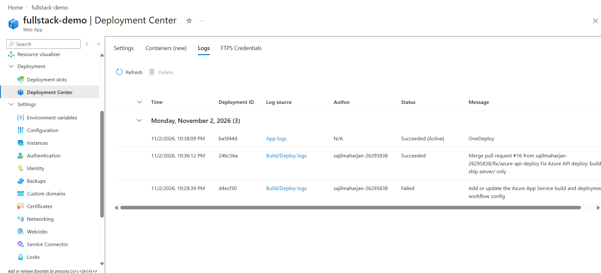
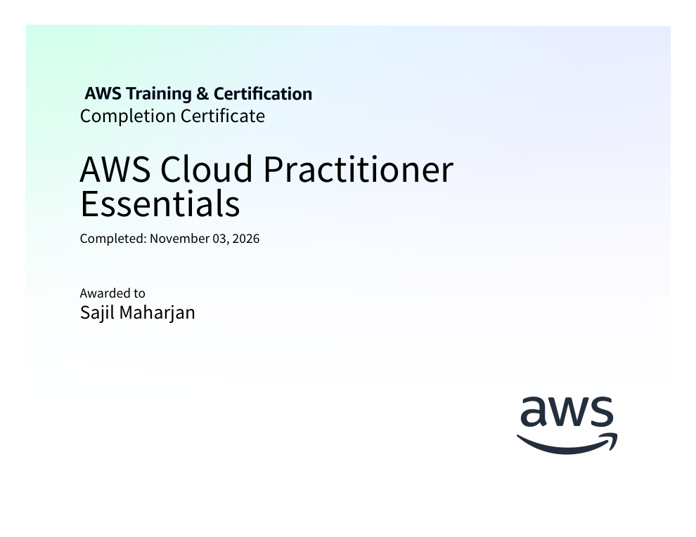
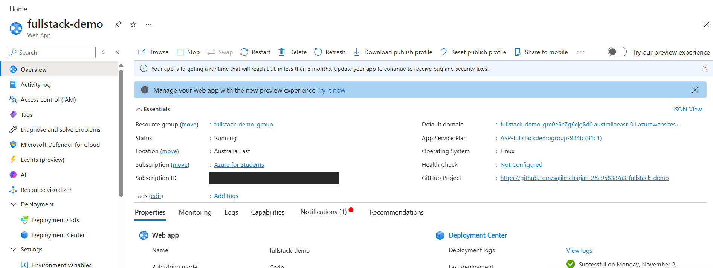
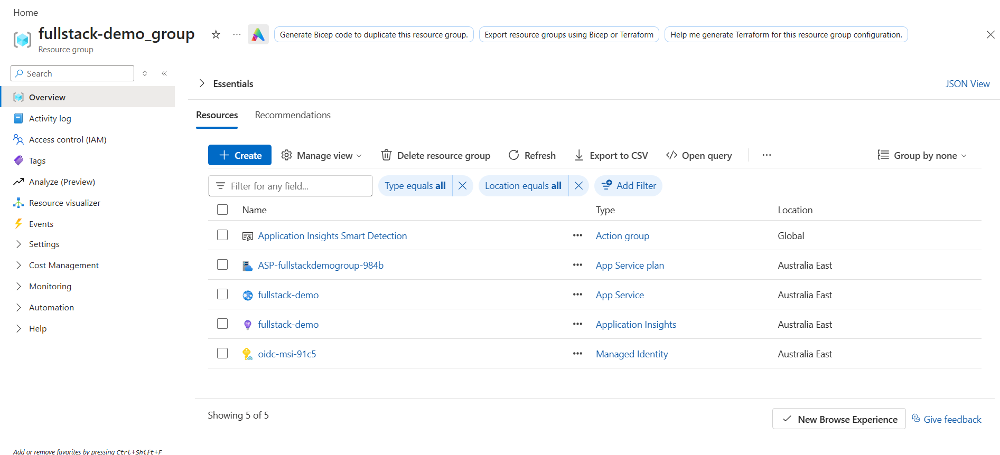
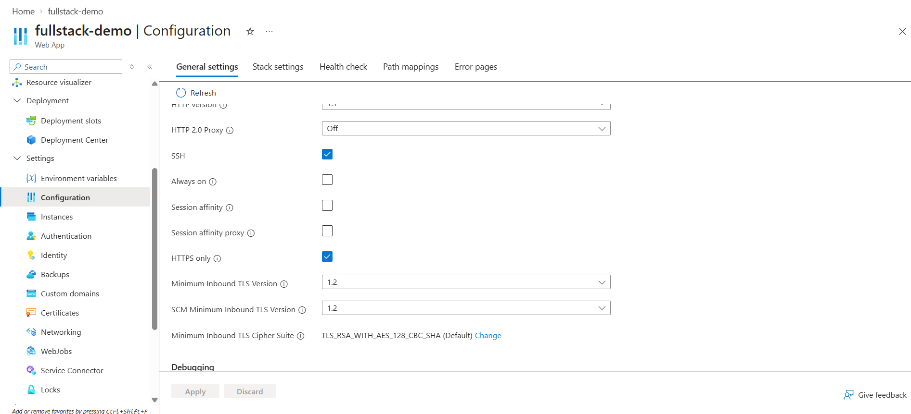
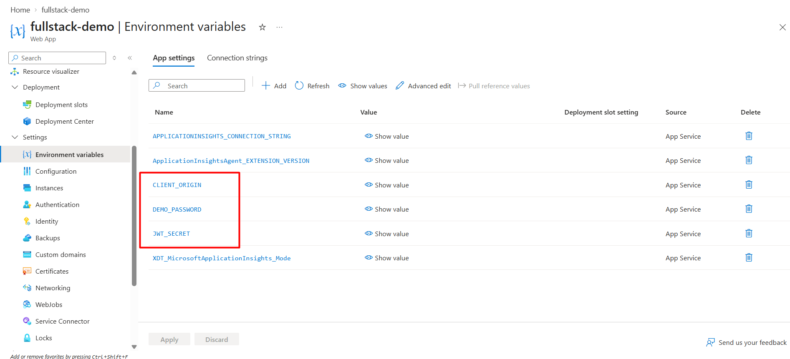

# Professional Learning Portfolio

**Sajil Maharjan · Student ID 26295838**
UTS 43030 Engineering & IT Professional Practice: Assessment Task 3, Professional Learning Report

This portfolio holds the evidence for my Professional Learning Report. It replaces Portfolium, which UTS is retiring in 2026 ([UTS notice](https://educationexpress.uts.edu.au/blog/2026/06/05/your-access-to-portfolium-is-changing/)). Each entry is linked to the goals in my Professional Learning Plan (Assessment Task 1).

My career goal is a senior full-stack developer role, such as those advertised by the Green Building Council of Australia and Greenstone Financial Services. Both roles ask for modern web development, CI/CD, cloud platforms and secure authentication and authorisation, and the five goals below target those requirements.

## Contents

| # | Entry | Plan goal(s) |
|---|-------|--------------|
| 1 | [Project Portal: full-stack app with authentication and RBAC](#1-project-portal-full-stack-app-with-authentication-and-rbac) | 3, 4, 5 |
| 2 | [Security audit against the OWASP Top 10](#2-security-audit-against-the-owasp-top-10) | 2, 5 |
| 3 | [CI/CD pipeline with GitHub Actions](#3-cicd-pipeline-with-github-actions) | 3 |
| 4 | [Cloud deployment on Azure and AWS Cloud Practitioner Essentials](#4-cloud-deployment-on-azure-and-aws-cloud-practitioner-essentials) | 4 |
| 5 | [Ethics and Indigenous professional capability](#5-ethics-and-indigenous-professional-capability) | 1 |
| 6 | [Cybersecurity foundations](#6-cybersecurity-foundations) | 2 |

**Learning Plan goals:** 1 Ethics and Indigenous capability · 2 Cybersecurity foundations · 3 Software development tools (CI/CD) · 4 Cloud computing · 5 Application security (authentication and RBAC)

---

## 1. Project Portal: full-stack app with authentication and RBAC
**Goals 3, 4, 5** · **Skills:** React, TypeScript, Node.js, Express, JWT, RBAC, REST API, automated testing, Azure, application security

I built, secured and deployed this full-stack web application as part of my Professional Learning Plan.
- **Client:** React and TypeScript.
- **API:** Node.js and Express.
- **Login:** passwords hashed with bcrypt, and JSON Web Tokens that expire after 15 minutes.
- **Role-based access control:** three roles (admin, editor and viewer), enforced on the server. The UI only hides the buttons a role can't use.
- **Hardening:** rate limiting on login, security headers, request size limits and input validation.
- **Tests:** 12 automated security tests.
- **Hosting:** the app runs live on Microsoft Azure.

**Links:** [Source code](https://github.com/sajilmaharjan-26295838/a3-fullstack-demo) · [Live app](https://delightful-flower-0c93a5d00.4.azurestaticapps.net) · [API health check](https://fullstack-demo-gre0e9c7g6cjg8d0.australiaeast-01.azurewebsites.net/api/health)

The same app gives each role a different view:

| Viewer (read only) | Editor (read and write) | Admin (all permissions) |
|---|---|---|
|  |  |  |

The editor creates a project, and the live API returns **201 Created**:

---

## 2. Security audit against the OWASP Top 10
**Goals 2, 5** · **Skills:** OWASP Top 10, security auditing, risk assessment, vulnerability management, secure coding

I audited Project Portal against the OWASP Top 10 (2021), focusing on the authentication, authorisation and encryption requirements in my target job advertisements. I used dependency scanning (`npm audit`), automated tests, live HTTP probing and code review.

The audit produced **six findings**:
- **One medium issue, fixed with regression tests.** Oversized requests returned a 500 error and logged a full stack trace.
- **Two accepted risks** with documented mitigations: a dev-only dependency advisory, and a long-lived deployment credential.
- **Three design limitations** recorded for future work.

It also verified **13 security controls**, including:
- brute-force protection (the 11th failed login gets HTTP 429)
- rejection of forged and `alg=none` tokens
- RBAC enforced on the server
- HTTPS-only access with TLS 1.2 as the minimum version

**Full report:** [SECURITY_AUDIT.md](SECURITY_AUDIT.md)

---

## 3. CI/CD pipeline with GitHub Actions
**Goal 3** · **Skills:** GitHub Actions, CI/CD, DevOps, Dependabot, CodeQL, Git

I designed four GitHub Actions workflows:
1. **[CI](.github/workflows/ci.yml):** test → lint → build → dependency-audit gate on every push and pull request
2. **[CodeQL](.github/workflows/codeql.yml):** static security analysis
3. **[API deployment](.github/workflows/main_fullstack-demo.yml):** deploys to Azure App Service, then runs a smoke test against `/api/health`
4. **[Client deployment](.github/workflows/azure-static-web-apps-delightful-flower-0c93a5d00.yml):** deploys to Azure Static Web Apps

Dependabot keeps dependencies up to date. The pipeline **blocked four incompatible dependency upgrades** before they reached `main`. I fixed the root cause by upgrading paired packages together and configuring Dependabot to [group linked packages](.github/dependabot.yml). I also completed the Canvas *GitHub Essentials* (9/10) and *GitHub Workflow* (10/10) modules.

**Links:** [Pipeline runs](https://github.com/sajilmaharjan-26295838/a3-fullstack-demo/actions)

Deploy job with the post-deployment health check passing:

Azure Deployment Center history. A failed first deployment (no `package.json` at the repo root) was followed by the fixed workflow succeeding:

---

## 4. Cloud deployment on Azure and AWS Cloud Practitioner Essentials
**Goal 4** · **Skills:** AWS, Microsoft Azure, App Service, Static Web Apps, cloud security, TLS, deployment

I completed **AWS Cloud Practitioner Essentials** (AWS Training & Certification, 3 November 2026), which covers cloud concepts, core services, the shared responsibility model and pricing. I then applied it by deploying Project Portal to Microsoft Azure:
- **API:** App Service (Linux, Node 22), with HTTPS only and TLS 1.2 as the minimum version.
- **Secrets:** stored in App Service settings, not in code.
- **Client:** Static Web Apps.

Along the way I worked through two problems:
- a regional deployment policy on my student subscription
- a GitHub OIDC incompatibility caused by GitHub's immutable subject claims

I recorded the resulting deployment-credential trade-off as audit finding F6.

**Certificate:** [AWS Cloud Practitioner Essentials (PDF)](portfolio/aws_cloud_practitioner_essentials_certificate.pdf)

| App Service overview (subscription ID redacted) | Resource group |
|---|---|
|  |  |

| HTTPS only and TLS 1.2 | Secrets held as app settings (values hidden) |
|---|---|
|  |  |

---

## 5. Ethics and Indigenous professional capability
**Goal 1** · **Skills:** professional ethics, Indigenous cultural capability, Indigenous Cultural and Intellectual Property (ICIP), responsible AI, professional communication

For the *Working Ethically and Indigenous Professional Capability* module, I wrote a professional email to management (Assessment Task 2, DesignR scenario). It responded to a plan to mass-produce AI-generated Aboriginal and Torres Strait Islander imagery.

I drew on four sources:
- the ACS Code of Professional Ethics
- the AIATSIS Code of Ethics
- the First Nations ICIP Protocols
- Article 31 of the UN Declaration on the Rights of Indigenous Peoples (UNDRIP)

Using them, I identified issues of consent, cultural integrity and self-determination. I recommended:
- pausing uploads and removing indefensible images
- partnering with Indigenous artists
- appointing a paid First Nations advisor
- adopting ICIP and responsible-AI policies

*The full email was submitted through Canvas (Assessment Task 2). It isn't published here, to protect academic integrity.*

---

## 6. Cybersecurity foundations
**Goal 2** · **Skills:** cybersecurity fundamentals, threat modelling, authentication, encryption

I completed the Canvas *Introduction to Cybersecurity* modules. The topics were entirely new to me and needed independent research beyond the modules:
- threats and vulnerabilities
- secure coding
- authentication and authorisation
- encryption in transit and at rest

I then applied this knowledge in the security audit of my own application (Entry 2).

| Assessment | Score |
|---|---|
| Cybersecurity Quiz 1 | 18.5 / 20 (92.5%) |
| Cybersecurity Quiz 2 | 19 / 20 (95%) |
| GitHub Essentials Quiz 1 | 9 / 10 |
| GitHub Workflow Quiz 2 | 10 / 10 |

<!-- Add the Canvas Grades screenshot here once taken:

-->

---
*Last updated: November 2026. Screenshots are redacted: browser address bars, account email and Azure subscription ID removed.*
